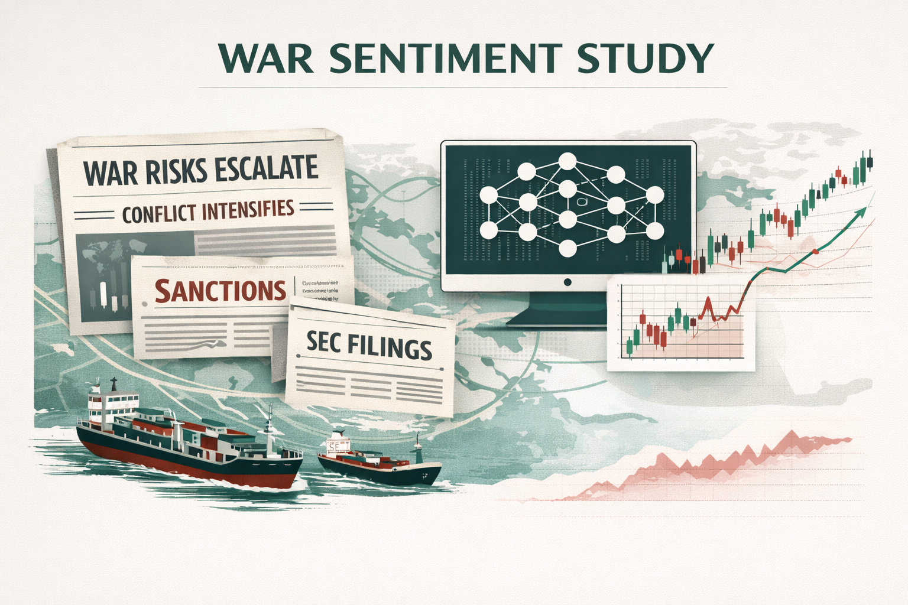
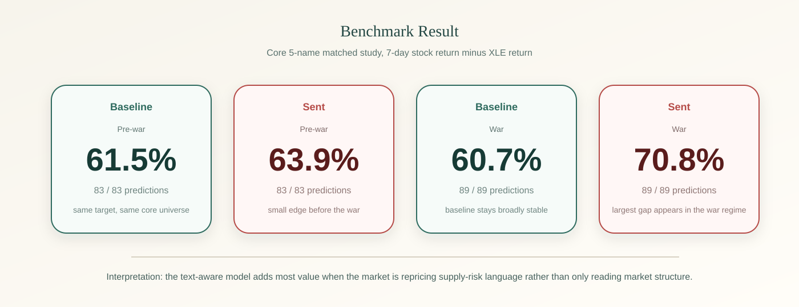
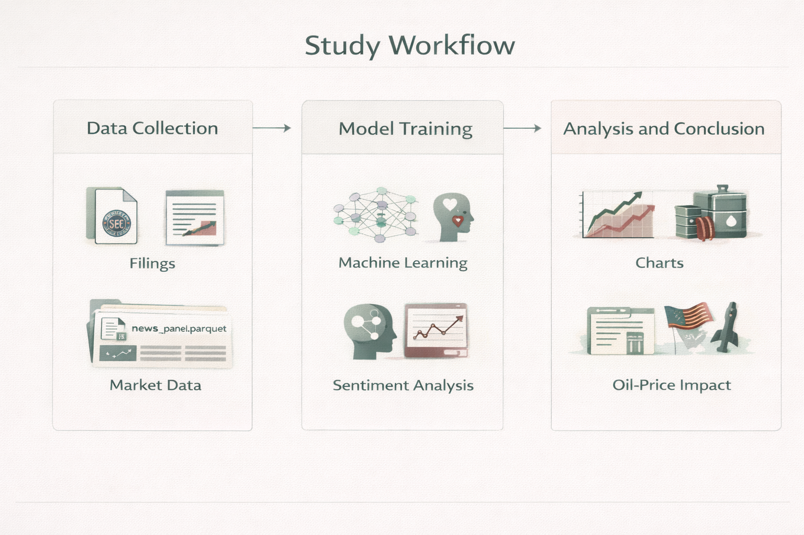
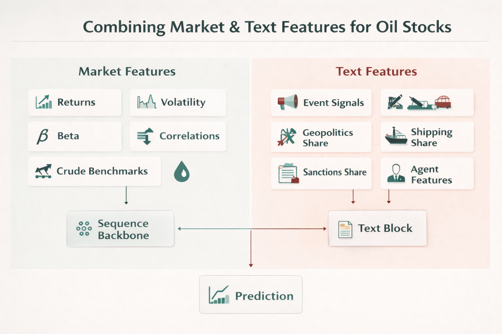
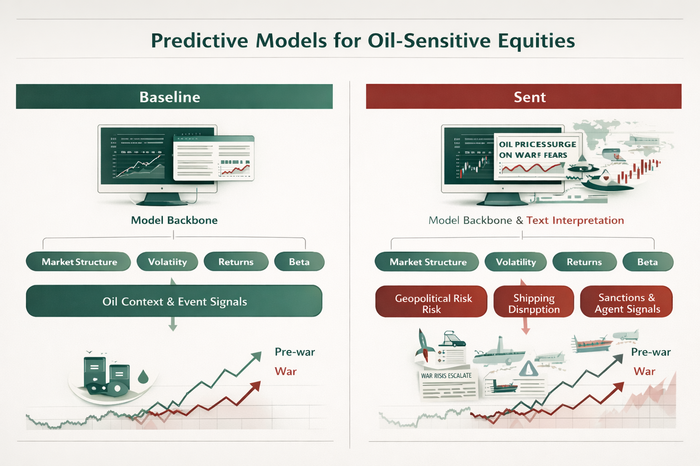

# War Sentiment Study

  

## Introduction / Research Question

This study asks one question:

> **Does text-based geopolitical sentiment improve oil-stock prediction when the market moves from normal trading conditions into a war-driven supply-risk regime?**

The study compares two matched models:

<table>
  <tr>
    <td width="50%" valign="top">
      <h3>Baseline</h3>
      
Uses market structure, oil context, volatility, beta, correlations, and dated event signals.

    </td>
    <td width="50%" valign="top">
      <h3>Sent</h3>
      
Uses the same market backbone and adds text interpretation from filings, sentiment, topic shares, event language, and theory-agent features.

    </td>
  </tr>
</table>

The target is the stock’s **next 7-day return minus XLE’s next 7-day return**. This means the model is not trying to predict whether the whole energy sector goes up. It is trying to predict whether the selected stock outperforms or underperforms the energy-sector benchmark by more than `1%`.

<table>
  <tr>
    <td width="50%" valign="top">
      <strong>Pre-war window</strong> 
      <code>2025-04-14</code> to <code>2025-06-12</code>
    </td>
    <td width="50%" valign="top">
      <strong>War window</strong> 
      <code>2025-06-13</code> to <code>2025-08-11</code>
    </td>
  </tr>
</table>

---

## Results / Conclusion

The benchmark is intentionally narrow. It uses the core `5`-name matched study set so the comparison stays focused on the value of the added text layer.

<table>
  <tr>
    <td width="25%" valign="top">
      <h3>Baseline</h3>
      <strong>Pre-war</strong> 
      <code>0.6145</code> 
      <code>83 / 83</code>
    </td>
    <td width="25%" valign="top">
      <h3>Baseline</h3>
      <strong>War</strong> 
      <code>0.6067</code> 
      <code>89 / 89</code>
    </td>
    <td width="25%" valign="top">
      <h3>Sent</h3>
      <strong>Pre-war</strong> 
      <code>0.6386</code> 
      <code>83 / 83</code>
    </td>
    <td width="25%" valign="top">
      <h3>Sent</h3>
      <strong>War</strong> 
      <code>0.7079</code> 
      <code>89 / 89</code>
    </td>
  </tr>
</table>

<table>
  <tr>
    <td width="48%" valign="top">
      
    </td>
    <td width="52%" valign="top">
      <h3>What the result says</h3>
      
Before the war, the models are close. During the war, the text-aware model separates clearly.

      
The result supports the project idea: text becomes more useful when oil stocks are being repriced around sanctions, shipping risk, escalation, and official supply-risk language.

      
The reported <code>Sent</code> benchmark uses the selected blend: <code>25%</code> baseline probability and <code>75%</code> text-aware probability.

      
The caveat is sample size. The war result is based on <code>89 / 89</code> predictions in a narrow <code>5</code>-name benchmark. It should be read as strong evidence inside this setup, not as proof that the model generalizes across all oil equities.

    </td>
  </tr>
</table>

---

## Approach / How the Study Is Set Up

<table>
  <tr>
    <td width="52%" valign="top">
      <h3>Project flow</h3>
      
<strong>1. Gather data</strong> Collect filings, market data, event rows, sentiment scores, topic features, and theory-agent features.

      
<strong>2. Build panels</strong> Align everything by date and ticker so the model receives one daily row per stock.

      
<strong>3. Train matched LSTMs</strong> Use the same sequence backbone for both models. Only the text layer changes.

      
<strong>4. Explain the shift</strong> Compare pre-war and war performance, then inspect which feature groups carry the result.

    </td>
    <td width="48%" valign="top">
      
    </td>
  </tr>
</table>

### Notebook Order

<table>
  <tr>
    <th align="left">Order</th>
    <th align="left">Notebook</th>
    <th align="left">Purpose</th>
  </tr>
  <tr>
    <td>1</td>
    <td><a href="./00_data_collection.ipynb"><code>00_data_collection.ipynb</code></a></td>
    <td>Gathers the source layers and creates the processed panels.</td>
  </tr>
  <tr>
    <td>2</td>
    <td><a href="./01_training_lstm_pair.ipynb"><code>01_training_lstm_pair.ipynb</code></a></td>
    <td>Trains the matched Baseline and Sent LSTM models.</td>
  </tr>
  <tr>
    <td>3</td>
    <td><a href="./02_analysis_war_sentiment.ipynb"><code>02_analysis_war_sentiment.ipynb</code></a></td>
    <td>Explains why the result changes between the two windows.</td>
  </tr>
</table>

### Data Sources

<table>
  <tr>
    <th align="left">Source</th>
    <th align="left">How it supports the research question</th>
  </tr>
  <tr>
    <td><strong>SEC EDGAR filings</strong></td>
    <td>Company language about exposure, risk, operations, supply chains, and sanctions.</td>
  </tr>
  <tr>
    <td><strong>Yahoo Finance</strong></td>
    <td>Daily prices, returns, volatility, crude benchmarks, sector context, beta, and correlations.</td>
  </tr>
  <tr>
    <td><strong>GDELT topic features</strong></td>
    <td>Public topic attention around war, shipping, sanctions, and supply risk. These are gathered into the panel; the selected benchmark keeps the active LSTM feature set narrower.</td>
  </tr>
  <tr>
    <td><strong>FinBERT sentiment</strong></td>
    <td>Finance-tuned filing sentiment. VADER is used as fallback when FinBERT scoring is unavailable.</td>
  </tr>
  <tr>
    <td><strong>Official event rows</strong></td>
    <td>Dated geopolitical catalysts that can be aligned with price reactions.</td>
  </tr>
  <tr>
    <td><strong>Statement event rows</strong></td>
    <td>Policy and supply-risk statements that may move expectations before returns fully adjust.</td>
  </tr>
  <tr>
    <td><strong>Theory-agent features</strong></td>
    <td>Structured interpretations of political risk, company exposure, market stress, and war alignment.</td>
  </tr>
</table>

---

## Feature Engineering

The model does not receive raw prices and raw filing text directly. The data is transformed into candidate alpha features: signals that might help predict future relative returns.

<table>
  <tr>
    <td width="50%" valign="top">
      
    </td>
    <td width="50%" valign="top">
      <h3>Candidate alphas</h3>
      
<strong>Market alphas</strong> Returns, volatility, beta, correlations, volume shocks, crude context.

      
<strong>Event alphas</strong> Official events, statement events, policy timing, war-window pressure.

      
<strong>Text alphas</strong> Sentiment, geopolitics, shipping, sanctions, supply-risk language.

      
<strong>Theory-agent alphas</strong> Political risk, company exposure, market stress, war alignment.

    </td>
  </tr>
</table>

<table>
  <tr>
    <th align="left">Feature family</th>
    <th align="left">Examples</th>
    <th align="left">Why it matters</th>
  </tr>
  <tr>
    <td><strong>Lag and momentum</strong></td>
    <td><code>ret_1</code>, <code>ret_5</code>, <code>ret_10</code>, <code>prev_ret_1</code>, <code>prev_ret_5</code></td>
    <td>Captures short-term continuation or reversal.</td>
  </tr>
  <tr>
    <td><strong>Rolling risk</strong></td>
    <td><code>vol_5</code>, <code>vol_10</code>, <code>range_1</code>, <code>volume_z_20</code></td>
    <td>Identifies calm, stressed, or unusually active trading regimes.</td>
  </tr>
  <tr>
    <td><strong>Market structure</strong></td>
    <td><code>beta_xle_20</code>, <code>beta_oil_20</code>, <code>corr_xle_20</code>, <code>corr_oil_20</code></td>
    <td>Measures how tightly each stock is linked to energy and crude oil.</td>
  </tr>
  <tr>
    <td><strong>Oil and macro context</strong></td>
    <td><code>CL=F_ret_1</code>, <code>BZ=F_ret_5</code>, <code>SPY_ret_1</code>, <code>^VIX_ret_5</code></td>
    <td>Controls for broader oil, equity, and volatility conditions.</td>
  </tr>
  <tr>
    <td><strong>Text and event context</strong></td>
    <td><code>avg_sentiment</code>, <code>geopolitics_share</code>, <code>shipping_share</code>, <code>statement_event_weight_3d</code></td>
    <td>Tracks whether language and events point toward supply pressure or escalation.</td>
  </tr>
  <tr>
    <td><strong>Theory-agent features</strong></td>
    <td><code>agent_political_risk</code>, <code>agent_company_exposure</code>, <code>agent_market_stress</code>, <code>agent_war_alignment</code></td>
    <td>Turns the thesis into structured model inputs.</td>
  </tr>
</table>

---

## Theoretical Concepts Driving the Model

<table>
  <tr>
    <td width="34%" valign="top">
      <h3>Finance concept</h3>
      
Oil-sensitive stocks should react to crude prices, sector beta, volatility, and geopolitical supply risk.

    </td>
    <td width="33%" valign="top">
      <h3>Text concept</h3>
      
Filings and event language can describe risks before they are fully visible in returns.

    </td>
    <td width="33%" valign="top">
      <h3>ML concept</h3>
      
A sequence model can combine weak signals through time into a clearer predictive pattern.

    </td>
  </tr>
</table>

The point is not that one feature should explain the result alone. The point is that economically related features may work together. The Baseline tests whether market and event structure are enough. The Sent model tests whether adding interpreted text improves the same setup during a geopolitical regime shift.

### Why an LSTM

<table>
  <tr>
    <td width="50%" valign="top">
      <h3>Sequence logic</h3>
      
The LSTM reads a rolling <code>20</code>-day sequence. That gives the model recent market memory instead of one isolated row.

      
This fits the finance problem because war risk, shipping stress, volatility, and sentiment usually build over several days rather than appearing cleanly on one date.

    </td>
    <td width="50%" valign="top">
      
    </td>
  </tr>
</table>

---

## Training Setup

The training notebook follows the standard deep-learning workflow, but it is grouped into one training notebook instead of nine separate notebooks.

<table>
  <tr>
    <th align="left">Standard step</th>
    <th align="left">What happens here</th>
  </tr>
  <tr>
    <td><strong>Feature selection</strong></td>
    <td>Select market, event, filing-text, sentiment, and theory-agent inputs that match the oil-supply-risk thesis.</td>
  </tr>
  <tr>
    <td><strong>Feature engineering</strong></td>
    <td>Build lagged returns, rolling volatility, beta, correlations, sentiment scores, event windows, and agent features.</td>
  </tr>
  <tr>
    <td><strong>Data preprocessing</strong></td>
    <td>Merge daily ticker rows, fill missing feature values, standardize inputs, and create rolling sequences.</td>
  </tr>
  <tr>
    <td><strong>Train-validation-test split</strong></td>
    <td>Use monthly walk-forward testing. Earlier data trains the model, the latest training tail validates it, and the next month is tested out of sample.</td>
  </tr>
  <tr>
    <td><strong>Architecture</strong></td>
    <td>Use a PyTorch LSTM backbone with ticker embeddings. Sent adds a static text-feature block.</td>
  </tr>
  <tr>
    <td><strong>Training loop</strong></td>
    <td>Forward pass, binary classification loss, backward pass, Adam update, validation check, and early stopping.</td>
  </tr>
  <tr>
    <td><strong>Hyperparameters</strong></td>
    <td>Sequence length <code>20</code>, max epochs <code>14</code>, batch size <code>64</code>, learning rate <code>1e-3</code>.</td>
  </tr>
  <tr>
    <td><strong>Evaluation</strong></td>
    <td>Report pre-war and war accuracy on the same matched prediction rows.</td>
  </tr>
  <tr>
    <td><strong>Discussion</strong></td>
    <td>Use the analysis notebook to explain which feature groups help or hurt in each regime.</td>
  </tr>
</table>

### Training Loop

<table>
  <tr>
    <td width="33%" valign="top">
      <h3>Forward pass</h3>
      
The model reads the 20-day sequence and outputs a logit for the next 7-day relative-return class.

    </td>
    <td width="34%" valign="top">
      <h3>Loss and gradients</h3>
      
The loss is <code>BCEWithLogitsLoss</code>, not MSE, because this is classification. PyTorch then computes gradients with backpropagation.

    </td>
    <td width="33%" valign="top">
      <h3>Update and validate</h3>
      
<code>Adam</code> updates weights. Validation loss controls early stopping with patience <code>3</code>.

    </td>
  </tr>
</table>

<table>
  <tr>
    <th align="left">Concept</th>
    <th align="left">Benchmark setting</th>
  </tr>
  <tr>
    <td><strong>Input sequence</strong></td>
    <td><code>20</code> trading days</td>
  </tr>
  <tr>
    <td><strong>Prediction horizon</strong></td>
    <td>Next <code>7</code> trading days</td>
  </tr>
  <tr>
    <td><strong>Optimizer</strong></td>
    <td><code>Adam</code></td>
  </tr>
  <tr>
    <td><strong>Loss function</strong></td>
    <td><code>BCEWithLogitsLoss</code> with positive-class weighting for imbalance</td>
  </tr>
  <tr>
    <td><strong>Threshold</strong></td>
    <td>Selected on validation, then applied to the next test month</td>
  </tr>
</table>

---

## Files Produced

<table>
  <tr>
    <th align="left">Path</th>
    <th align="left">Purpose</th>
  </tr>
  <tr>
    <td><code>data/processed/raw_news.parquet</code></td>
    <td>Filing-level text records.</td>
  </tr>
  <tr>
    <td><code>data/processed/news_panel.parquet</code></td>
    <td>Daily text, event, sentiment, and theory-agent features.</td>
  </tr>
  <tr>
    <td><code>data/processed/quant_panel.parquet</code></td>
    <td>Daily market, oil, volatility, beta, and correlation features.</td>
  </tr>
  <tr>
    <td><code>artifacts/</code></td>
    <td>Predictions, metrics, feature weights, event-source files, and reference checkpoints.</td>
  </tr>
  <tr>
    <td><code>src/oil_projects/</code></td>
    <td>Study code used by the notebooks.</td>
  </tr>
</table>

---

## Bottom Line

The benchmark result is strongest during the war window:

<table>
  <tr>
    <th align="left">Model</th>
    <th align="left">Pre-war</th>
    <th align="left">War</th>
  </tr>
  <tr>
    <td><strong>Baseline</strong></td>
    <td><code>0.6145</code> on <code>83 / 83</code></td>
    <td><code>0.6067</code> on <code>89 / 89</code></td>
  </tr>
  <tr>
    <td><strong>Sent</strong></td>
    <td><code>0.6386</code> on <code>83 / 83</code></td>
    <td><code>0.7079</code> on <code>89 / 89</code></td>
  </tr>
</table>

That is the red thread of the project: market features explain part of oil-stock behavior, but the added text layer becomes much more useful once the market regime is dominated by geopolitical supply-risk narratives.

The shift is also visible in the feature analysis:

<table>
  <tr>
    <th align="left">Before the war, more relevant</th>
    <th align="left">During the war, more relevant</th>
    <th align="left">During the war, less clean on its own</th>
  </tr>
  <tr>
    <td valign="top">
      <strong>Market structure</strong> 
      returns, volatility, beta, correlations, crude context  
      <strong>Short-term price behavior</strong> 
      lagged returns, recent trend, reversal, and rolling risk  
      These features explain why the Baseline is already useful before the war.
    </td>
    <td valign="top">
      <strong>Policy and event signals</strong> 
      <code>statement_event_weight_3d</code>, <code>statement_shipping_weight_3d</code>  
      <strong>Sentiment and supply-risk language</strong> 
      <code>geopolitics_share</code>, <code>shipping_share</code>, <code>supply_risk_intensity</code>, <code>supply_disruption_share</code>  
      <strong>Agent-style interpretation</strong> 
      political risk, company exposure, market stress, and war alignment
    </td>
    <td valign="top">
      <strong>Pure market structure</strong> 
      returns, volatility, beta, correlations, crude context  
      These features still matter, and they keep the Baseline useful. But during war they become less sufficient by themselves because the market is reacting to new information about sanctions, shipping, escalation, and supply disruption.
    </td>
  </tr>
</table>

In plain terms: before the war, recent prices, volatility, oil context, and sector structure carry much of the signal. During the war, those features still help, but the extra edge comes from understanding what the text and dated events say about geopolitical supply risk.

The result should still be interpreted with discipline. The benchmark is intentionally focused, and the sample size is small. The study shows that the text layer helped in this matched war-window setup; it does not claim that the same accuracy is guaranteed in a broader deployment universe.
